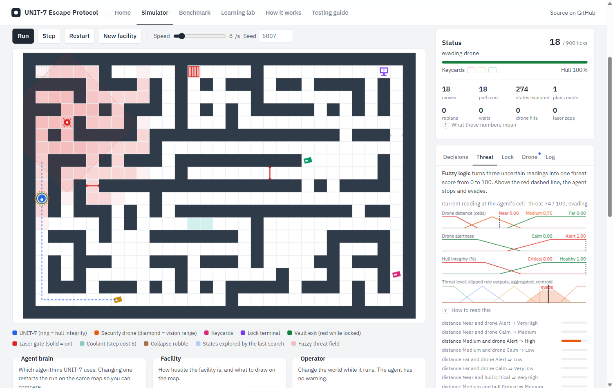

# UNIT-7 Escape Protocol

An AI escape room. A maintenance android, UNIT-7, has to escape a research facility that keeps changing around it. It must collect three keycards, crack a vault lock and reach the exit, while a drone hunts it, laser gates switch on and off, ceilings collapse onto its planned route and power surges rewire the lock.

The agent combines six AI techniques: **A\* search** (planned in space and time), **constraint satisfaction**, a **behaviour tree**, **fuzzy logic**, a **finite state machine** and **Q-learning**.



## Quick start

| What you want | How |
|---|---|
| Use it | Open the deployed site, or double-click `index.html` (no install or build needed). |
| Run the tests | Open the **Testing guide** page and press *Run all tests*, or run `npm test`. |
| Reproduce the results | Run `npm run bench` (100 facilities, about a minute; writes `results/`). |
| Serve it locally | Run `npm start`, then open http://localhost:3000. |

You need Node.js 18 or later for the commands. There are no dependencies to install.

## The website

| Page | What it does |
|---|---|
| **Home** | What the project is, how each requirement of the brief is met, and a live run. |
| **Simulator** | Watch the agent live. Explained panels show its behaviour tree, fuzzy threat reasoning, lock solver and the drone's state machine. You can change the facility while it runs, and eight guided scenarios each show one behaviour. |
| **Benchmark** | Run hundreds of missions across seven agent designs and compare success rate, completion time, path cost and states explored. Includes a planner comparison, a solver comparison and CSV export. |
| **Learning lab** | Train a Q-learning agent, inspect its learned values and policy, then collapse its route and compare it with A\*. |
| **How it works** | Each technique explained, with a link to see it in the simulator. |
| **Testing guide** | Runs all 19 tests in the browser, plus a checklist for every requirement in the brief, linked to pre-configured scenarios. |

Simulator links can set it up directly, for example `simulator.html?scenario=block` or `simulator.html?seed=5033&dyn=normal&time=0`. The parameters are:

- `scenario`: one of escape, block, surge, script, gates, alarm, csp, chaos
- `seed`: which facility to generate
- `dyn`: off, normal or chaos
- `algo`: astar, dijkstra, greedy or bfs
- `csp`: bt, fc, mrv_fc or mrv_fc_ac3
- `fuzzy`, `time`, `adaptive`: set to 0 to switch that feature off
- `autoplay`: set to 0 to start paused

## Results (100 held-out facilities)

| | Static | Dynamic | Chaos |
|---|---|---|---|
| UNIT-7 (all techniques) | 100% | **100%** | **95%** |
| Fixed script (plans once, never adapts) | 100% | 32% | 11% |

- **Search:** A\* explores 38% fewer states than Dijkstra over a whole mission and is optimal on every test query.
- **Lock solving:** MRV + forward checking + AC-3 needs 8 assignments where plain backtracking needs about 1,400.
- **Laser gates:** planning in time cuts laser hits from 0.36 to 0.01 per run.

The full method and results, including where the agent falls short, are in [REPORT.md](REPORT.md).

## Deploy your own copy

The site is static HTML, CSS and JavaScript.

- **Vercel:** import the repository at vercel.com/new and press Deploy (`vercel.json` is included), or run `npx vercel` from this folder.
- **GitHub Pages:** go to Settings → Pages, deploy from the `main` branch, root folder.

## Project layout

```
index.html, simulator.html, benchmark.html,
learning.html, how-it-works.html, testing.html   the website
css/style.css                                    styles
js/core/   engine (shared by the browser and Node)
           world, search, csp, fuzzy, bt, drone, agent, sim, qlearn, bench, tests
js/ui/     page scripts (site chrome, simulator, benchmark, lab, testing, home)
tools/     test.js, bench.js, serve.js, load.js (Node entry points)
results/   benchmark output used in the report
docs/      screenshots
```
