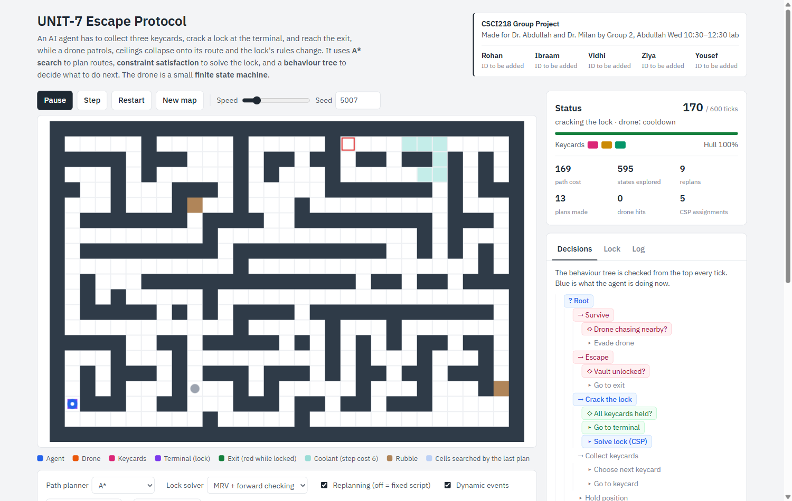

# UNIT-7 Escape Protocol

**CSCI218 Group Project (Topic 10: AI Escape Room).** Made for Dr. Abdullah and Dr. Milan by Group 2, Abdullah Wed 10:30–12:30 lab.

| Member | Student ID |
|---|---|
| Rohan | to be added |
| Ibraam | to be added |
| Vidhi | to be added |
| Ziya | to be added |
| Yousef | to be added |

An AI agent escapes a grid facility. It collects three keycards, solves a lock puzzle at a terminal, and reaches the exit, while a drone patrols, ceilings collapse onto its route and the lock's rules change mid-run.

- **A\* search** plans the routes and replans when the route is blocked.
- **Constraint satisfaction** solves the lock (backtracking with MRV and forward checking).
- **A behaviour tree** decides what to do each tick.
- **A finite state machine** controls the drone.



## Run it

- **In a browser:** open `index.html`, or visit the live copy at https://ai-escape-room-self.vercel.app
- **Tests:** `npm test` (9 tests)
- **Evaluation:** `npm run bench` (100 maps per agent; writes `results/summary.md` and `results/missions.csv`)

You need Node.js 18 or later for the commands. There is nothing to install.

## Results (100 maps, dynamic events on)

| Agent | Success rate | Ticks | Path cost | States explored |
|---|---|---|---|---|
| A* + behaviour tree | 97% | 232 | 218 | 2,661 |
| Dijkstra + behaviour tree | 97% | 230 | 215 | 3,586 |
| BFS + behaviour tree | 97% | 228 | 219 | 3,598 |
| Fixed script (no replanning) | 20% | 133 | 130 | 378 |

The design, implementation and full results are in [REPORT.md](REPORT.md).

## Files

```
index.html          the web page
css/style.css       styles
js/core/            engine: world, search, csp, bt, drone, agent, sim, bench, tests
js/ui/app.js        page logic (drawing, panels, evaluation table)
tools/              Node scripts: test.js, bench.js, serve.js, load.js
results/            evaluation output used in the report
```
