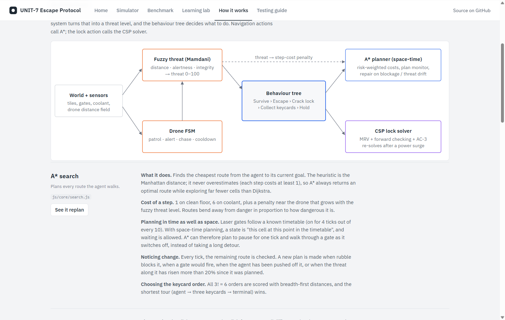

# UNIT-7 Escape Protocol: an intelligent agent for dynamic puzzle solving

## 1. Overview

UNIT-7 is a maintenance android trapped in a research facility. The facility is a procedurally generated 31×21 grid world built from a maze with extra loops and open rooms, and every map is reproducible from a seed. To escape, the agent must:

1. collect **three keycards**, choosing the order itself,
2. reach the **lock terminal** and deduce the vault code from the clues printed there (a constraint satisfaction puzzle),
3. reach the **vault exit** while the code is still valid.

The environment changes during execution, so a fixed action sequence fails (Section 5 measures how often):

| Dynamic element | Mechanism |
|---|---|
| **Security drone** | Moves every tick and is controlled by an FSM (Patrol, Alert, Chase, Cooldown). It detects the agent by radius plus line of sight. Contact costs 25% integrity and a 2-tick stun. |
| **Ceiling collapses** | Scheduled events that turn a cell **2–12 steps ahead on the agent's current planned route** into rubble. The cell is chosen so that all objectives stay reachable. |
| **Laser gates** | Corridor cells that are ON for 4 of every 10 ticks, each with its own phase. Standing in an active gate costs 12% integrity. |
| **Coolant leak** | Spreads one cell at a time. Coolant cells cost 6 instead of 1 and damage the hull. |
| **Power surge** | Rewires two lock dials. Clues that no longer hold are removed and new ones are added, so the constraint set changes mid-run and a known code becomes invalid. |
| **Operator** | In the app, the user can drop rubble, spill coolant, move the drone, trigger events or sound an alarm at any time. |

Dynamics have three levels: **Static** (none), **Dynamic** (drone, gates, 3 collapses, 1 surge) and **Chaos** (drone with radius 6, 6 collapses, 2 surges, faster leak).

## 2. Architecture



Each tick: scheduled events fire, coolant spreads, sensors update (a BFS distance field from the drone and a fuzzy threat table), the agent's behaviour tree ticks, the drone's FSM ticks, then collisions and win/lose conditions are resolved. The engine (`js/core/`) has no DOM dependency, so the browser app and the Node test and benchmark tools run identical code.

## 3. AI techniques

### 3.1 A* search with plan monitoring and repair (`search.js`, `agent.js`)

- **Search.** A*, Dijkstra (uniform cost), Greedy best-first and BFS share one implementation. A* uses the Manhattan heuristic, which is admissible because the minimum step cost is 1, and breaks ties toward larger *g*.
- **Cost model.** Step cost = 1, +5 on coolant, + a **fuzzy threat penalty** `(threat − 15)/85 × 30` near the drone. Routes therefore bend away from danger in proportion to how dangerous it is.
- **Space-time planning.** The state is *(cell, t mod 10)* and a WAIT action is allowed. Arrival at every cell is checked against the gate schedule at the actual arrival time, so the agent plans to pause and pass through a gate the moment it switches off. *Snapshot* planning (gates frozen at planning time) is kept as an ablation.
- **Plan monitoring.** Every tick the remaining plan is validated and repaired when:
  - a cell has become rubble ("route blocked"),
  - a gate would fire ("gate timing"),
  - the agent is no longer on the plan, after an evasion or a zap ("deviated"),
  - or the risk-weighted cost of the remaining route rose more than 20% since planning ("threat drift").
- **Mission planning.** The keycard order is chosen by evaluating all 3! tours (agent → k₁ → k₂ → k₃ → terminal) with BFS distances. This is re-evaluated as the map changes.

### 3.2 Constraint satisfaction (`csp.js`)

- **Model.** Variables D1–D5, domains {0..9}. Constraint types:
  - AllDifferent,
  - an optional checksum,
  - unary clues (parity, primality, bounds),
  - binary clues (*Di + Dj = k*, *Di > Dj*, *|Di − Dj| = k*).
- **Puzzle generation.** Random true clues are added until the solution count is exactly 1. Then every clue whose removal keeps the solution unique is deleted, which leaves a **minimal** puzzle (6.2 clues on average).
- **Solvers.** Four, in increasing strength:
  - plain chronological backtracking,
  - backtracking + forward checking,
  - + MRV with degree tie-break,
  - + node consistency and **AC-3** before search.
- **Effect on the mission.** Dialling in the code takes ⌈assignments/4⌉ ticks, so solver quality directly changes escape time.
- **Constraint change.** A power surge mutates the lock. The behaviour tree notices because "Vault unlocked?" now fails, and the CSP re-solves the new constraint set. If the surge happens mid-solve, partial work is discarded.

### 3.3 Behaviour tree (`bt.js`, `agent.js`)

A reactive tree (composites re-evaluated from the root every tick):

```
? Root
├─ → Survive          ◇ Threat high? (fuzzy)          ▸ Evade drone
├─ → Escape           ◇ Vault unlocked?                ▸ Navigate → exit
├─ → Crack the lock   ◇ All keycards held?             ▸ Navigate → terminal   ▸ Solve lock (CSP)
├─ → Collect keycards ▸ Optimise keycard tour          ▸ Navigate → keycard
└─ ▸ Hold position    (no route currently exists)
```

Because it is reactive, **Survive** pre-empts navigation the instant the threat crosses the threshold, and a power surge needs no special-case code: "Vault unlocked?" fails, so the tree drops to "Crack the lock".

### 3.4 Fuzzy logic (`fuzzy.js`)

A Mamdani system (min for AND, max aggregation, centroid defuzzification) with three inputs:

- **drone distance**, measured along corridors by BFS, so walls shield the agent: Near, Medium, Far,
- **drone alertness**, taken from its FSM state: Calm, Alert,
- **hull integrity**: Critical, Healthy.

Nine rules map these to a threat level from VeryLow to VeryHigh (0–100). For example: *IF distance is Near AND drone is Alert THEN threat is VeryHigh*; *IF distance is Medium AND integrity is Critical THEN threat is Medium*. A damaged agent therefore becomes more cautious.

The threat has two uses:

1. a per-cell cost penalty inside A*,
2. the BT condition *threat ≥ 68*, with 12 points of hysteresis, which triggers evasion. Evasion is a local BFS (depth 5) that picks the reachable cell minimising threat + 3 × distance.

### 3.5 Finite state machine (`drone.js`)

The drone is the adversary:

- Patrol → Alert when it sees the agent.
- In Alert it investigates the last-seen position. It moves to Chase if it still sees the agent after 2 ticks, and goes back to Patrol if it reaches that spot and finds nothing.
- Chase → Cooldown after 6 ticks without sight, or when its 30-tick battery runs out.
- Cooldown → Patrol after 12 ticks.

### 3.6 Reinforcement learning (`qlearn.js`, Learning lab)

Tabular Q-learning on a 17×11 facility with 2 keycards:

- **State:** (cell, keycard bitmask). **Actions:** N, E, S, W.
- **Rewards:** −1 per step, −5 for hitting a wall, +30 per new keycard, +100 for exiting with all keycards.
- **Parameters:** α = 0.2, γ = 0.97, ε-greedy with ε decaying from 1 to 0.05.

Q-learning is used as a **contrast to planning**, not as UNIT-7's controller: a learned policy cannot respond to a map change until it is retrained (Section 5.4).

## 4. Evaluation method

- `tools/bench.js` runs every configuration on the **same 100 seeded facilities** (seeds 5000–5099) at each dynamics level, with a 900-tick limit.
- The two tuned parameters were chosen on a **separate tuning set** (seeds 1000–1059) and not re-tuned on the test seeds: the fuzzy risk weight (30) and the evasion threshold (68).
- Measures: **success rate**; **completion time** (ticks); **path cost** (sum of step costs actually paid); **states explored** (A* node expansions, summed over all plans in the mission); replans by cause; drone hits; laser zaps; final integrity; planning time.
- Completion time and path cost are averaged over successful runs only.
- Full tables and per-episode CSVs are in `results/`.

Configurations:

| Id | Planner | Fuzzy | Space-time | Adaptive (BT + replanning) |
|---|---|---|---|---|
| **UNIT-7 full** | A* | ✓ | ✓ | ✓ |
| Snapshot | A* | ✓ | ✗ | ✓ |
| Crisp | A* | ✗, rule: "chasing and ≤ 3 cells" plus drone ±1 blocked | ✓ | ✓ |
| Dijkstra / Greedy / BFS | as named | ✓ | ✓ | ✓ |
| **Fixed script** | A*, planned once at t = 0 | ✗ | ✗ | ✗ |

## 5. Results

### 5.1 Missions (100 held-out facilities per cell)

**Success rate**

| Configuration | Static | Dynamic | Chaos |
|---|---|---|---|
| **UNIT-7 full** | 100% | **100%** | **95%** |
| A* + fuzzy, snapshot planning | 100% | 91% | 74% |
| A* + crisp avoidance | 100% | 100% | 98% |
| Dijkstra + fuzzy + space-time | 100% | 100% | 97% |
| Greedy + fuzzy + space-time | 100% | 95% | 84% |
| BFS + fuzzy + space-time | 100% | 97% | 83% |
| **Fixed script** | 100% | **32%** | **11%** |

**Dynamic facility in detail** (mean ± std)

| Configuration | Ticks | Path cost | States explored | Replans | Drone hits | Laser zaps | Integrity |
|---|---|---|---|---|---|---|---|
| UNIT-7 full | 195 ± 72 | 198 ± 74 | 14,671 | 7.6 | 0.08 | 0.01 | 93 |
| Snapshot | 227 ± 115 | 227 ± 108 | 6,766 | 17.8 | 0.16 | 0.36 | 85 |
| Crisp | 180 ± 78 | 176 ± 71 | 10,817 | 3.5 | 0.08 | 0.00 | 94 |
| Dijkstra | 197 ± 74 | 199 ± 76 | 23,805 | 7.8 | 0.11 | 0.00 | 93 |
| Greedy | 197 ± 70 | 207 ± 76 | 5,714 | 11.2 | 0.38 | 0.00 | 81 |
| BFS | 177 ± 66 | 188 ± 78 | 24,181 | 9.5 | 0.32 | 0.00 | 82 |
| Fixed script | 122 ± 22 | 123 ± 26 | 309 | 0 | 1.70 | 0.19 | 54 |

Why UNIT-7 replanned (Dynamic, per episode): route blocked 1.33, gate conflict **0.00**, threat drift / drone 5.66, deviated 0.63.

**Findings**

1. **Adaptation is what makes the agent succeed.** On a static map the fixed script is as good as anything (100%). With dynamics it collapses to 32% (Dynamic) and 11% (Chaos). Its failures split almost evenly between timing out (stuck at rubble it cannot route around, or at a door relocked by a surge: 34 and 40 runs) and being destroyed (1.7–2.2 drone hits per run: 34 and 49 runs). Its low completion time is a survivorship effect: it only finishes on maps where nothing went wrong. The adaptive agents are 95–100%.
2. **Space-time planning removes laser-gate failures.** Snapshot planning replans 2.3× more (17.8 vs 7.6), gets zapped 36× more often (0.36 vs 0.01 per run) and drops to 91% / 74% success. Space-time A* never needed a gate-caused replan.
3. **A* is the right planner.** It matches Dijkstra's success and path cost while exploring **38% fewer states** over a whole mission. Greedy explores least but is less reliable (84% in Chaos) and takes the most hits, because its paths ignore cost, including the threat cost. BFS also ignores cost and takes roughly 4× more drone hits than A*.
4. **Fuzzy vs crisp threat handling (an honest result).** The fuzzy agent did **not** beat the crisp baseline on success: 100% vs 100% in Dynamic, and 95% vs 98% in Chaos (3 runs out of 100, within noise). It was slower in Dynamic (195 vs 180 ticks). The crisp baseline is stronger than it looks, because it *hard-blocks* every cell next to the drone during planning. The fuzzy agent instead *trades off* risk against distance, so it sometimes accepts a risky shortcut. That trade-off pays off in Chaos, where fuzzy explores fewer states (18.6k vs 23.4k) and finishes faster (225 vs 235 ticks). Tuning the fuzzy agent mattered: with the untuned risk weight of 10 it reached 90% in Chaos on the tuning seeds against crisp's 95% (54 vs 57 of 60), and tuning closed that gap there (Section 6). The fuzzy controller's main advantage is graded, explainable behaviour (the rule strengths are visible live in the app) rather than raw success rate.

### 5.2 Planner micro-benchmark (200 identical queries, coolant-weighted costs)

| Planner | States explored | Path cost | Optimal | Cost above optimal |
|---|---|---|---|---|
| A* | **118 ± 87** | 45.5 | **100%** | 0.0% |
| Dijkstra | 209 ± 98 | 45.5 | 100% | 0.0% |
| Greedy best-first | 53 ± 30 | 54.2 | 36% | +19.0% |
| BFS | 210 ± 98 | 49.4 | 48% | +8.0% |
| A* snapshot (gates on) | 121 ± 88 | 46.6 | n/a | n/a |
| A* space-time (gates on) | 830 ± 786 | 45.8 | n/a | n/a |

A* is optimal on every query, as admissibility guarantees (also checked by `tools/test.js`), and explores 44% fewer states than Dijkstra. Space-time search costs about 7× more states per query, about 0.5 ms, which is cheap given that it removes all gate failures.

### 5.3 CSP solvers (100 generated locks)

| Solver | Assignments | Backtracks | Constraint checks | Correct |
|---|---|---|---|---|
| Plain backtracking | 1,396.7 | 1,391.7 | 3,088 | 100% |
| + forward checking | 61.8 | 56.8 | 1,927 | 100% |
| MRV + forward checking | 25.0 | 20.0 | 1,253 | 100% |
| **MRV + FC + AC-3** | **8.4** | **3.5** | **896** | 100% |

MRV + FC + AC-3 needs **166× fewer assignments** than plain backtracking. In the mission this is the difference between about 3 ticks and about 350 ticks at the terminal. All generated locks were verified to have exactly one solution, before and after every power surge.

### 5.4 Learning vs planning

| | Learned policy | A* |
|---|---|---|
| Episodes until the greedy policy first escapes | 50–150 | 0 (no training) |
| Steps to escape on the trained map | optimal on 6 of 8 maps, within 9% on the other 2 | optimal |
| After a collapse on the learned route | **fails on 8 of 8 maps** (walks into the new wall) | replans instantly, under 1 ms |
| Recovery | 50–250 more episodes of training | n/a |

Q-learning gives cheap, near-optimal decisions once trained but cannot respond to change without retraining. That is why UNIT-7 uses planning for navigation and keeps learning in the lab as a comparison.

## 6. Design iterations

Benchmarking exposed problems that changed the design:

- **Livelock between agent and drone.** At first the drone froze when it spotted the agent; the agent backed away out of sight, the drone gave up, and the cycle repeated until the time limit (about 5% of runs). Two fixes: the drone now *investigates* the last-seen position, and the fuzzy rule *Near ∧ Calm* was lowered from High to Medium threat, so the agent can slip past a drone that is not hunting. Dynamic success went from 94% to 100%.
- **Risk weight tuning.** With a weak threat penalty (10) the fuzzy agent walked close to drones and was hit 0.53 times per Chaos run. A sweep on the tuning seeds chose weight 30 and threshold 68, which reduced hits to 0.23.
- **Honest highlighting.** The benchmark UI only marks a "best" completion time among configurations with at least 50% success, so the fixed script's survivorship-biased times are not shown as best.

## 7. Limitations and possible extensions

- The agent has full knowledge of the map. Partial observability, for example a sensor radius with map discovery, would make D* Lite-style incremental replanning worthwhile.
- Space-time planning knows the gate schedule but not the drone's future moves. A predictive drone model could feed time-indexed risk into the same search.
- Fuzzy membership functions were hand-designed. They could be tuned automatically, for example by a genetic algorithm over the benchmark.
- Q-learning is tabular. A function approximator could generalise across maps, which tabular Q-learning cannot.

## 8. Reproducing

```bash
npm test         # 19 tests: A*/Dijkstra optimality, space-time gate safety, CSP uniqueness, fuzzy monotonicity, BT pre-emption, determinism, adaptive vs fixed plan, RL convergence
npm run bench    # writes results/summary.md and per-episode CSVs (about 1 minute)
npm start        # serves the site at http://localhost:3000
```

In the website:
- The **Testing guide** page runs the same 19 tests in the browser and walks through each requirement with pre-configured simulator links.
- The **Benchmark** page reproduces the mission experiments.
